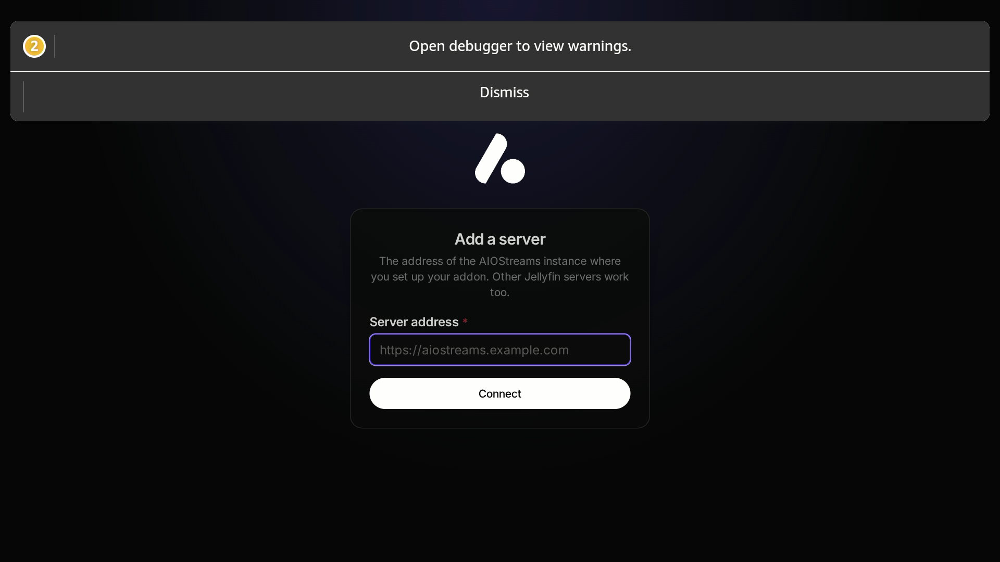

# AIOStreams for Vega OS

An **unofficial** Amazon Vega OS (Fire TV) port of the [AIOStreams](https://github.com/Viren070/AIOStreams)
web client: the client itself, unchanged in behaviour, inside a small React Native for Vega shell that
serves it from the app package in a Vega WebView.

This repository is a fork of AIOStreams. `main` is the upstream baseline (v2.38.1); the port lives on
the **`aiostreams-vegaos`** branch — an app in `packages/vega` and a small, reviewable set of changes to
the client in `packages/web`.



## What it does

- The full client on a Fire TV: home, discover, search, favourites, calendar, item pages, version
  lists, seasons and playback — laid out by the client's own TV mode at 1280×720.
- D-pad focus and focus rings, Back (closing a dialog before leaving the app), and the remote's
  transport keys.
- Sign-in with Quick Connect or a configuration's UUID and password; servers over HTTPS, or plain HTTP
  on a LAN.
- Playback through the page's own `<video>` with hls.js over MSE: H.264 and HEVC, including 4K HEVC
  Main 10.

## Feature status

Verified on a Fire TV Stick 4K (Vega OS 2.0, Vega WebView `Chrome/144.0.7559.246`):

| | |
| --- | --- |
| Browse, search, item pages, version lists | ✅ |
| D-pad navigation, Back, sign-in, HTTPS and HTTP servers | ✅ |
| Video: H.264, HEVC (incl. 4K HEVC Main 10) | ✅ |
| Audio: AAC, MP3, Opus, FLAC | ✅ |
| Audio: Dolby Digital, DD+, TrueHD, DTS, DTS-HD | ❌ the WebView decodes none of them |
| Choosing an audio track inside one file | ❌ no `audioTracks` API in the WebView |
| Subtitles, trailers, live TV, watch-together | ⚠️ untested |
| On-screen keyboard typing | ⚠️ partial (Select releases the field) |
| Downloads | ❌ no file save in a Vega WebView |

The audio gap is not a code bug: this WebView decodes no Dolby and no DTS, and the AIOStreams server
only direct plays, so a version carrying only a lossless track plays mute. The client now marks such
versions and prefers playable ones. [`packages/vega/PORTING_NOTES.md`](packages/vega/PORTING_NOTES.md)
has the measurements, and [`ROADMAP.md`](packages/vega/ROADMAP.md) the ways around it.

## Build and run

Prerequisites: Ubuntu/Linux or macOS, Node.js ≥ 20, pnpm ≥ 11, **Amazon Vega SDK 2.0.15159** with
**Vega CLI 1.4.9**, and a Fire TV running Vega OS 2.0 with Developer Mode on. The Vega Virtual Device
cannot run a WebView app on Ubuntu or Intel Macs — use a physical device.

```sh
git clone git@github.com:hina-raws/aiostreams-vegaos.git
cd aiostreams-vegaos
git checkout aiostreams-vegaos

pnpm install                     # the workspace, for the client
cd packages/vega
npm install --workspaces=false   # this package alone, outside the workspace

npm run sync-web                 # builds the client's standalone bundle into assets/
source ~/vega/env                # the SDK is not on PATH by default
npm run build:debug              # or npm run build:release

vega device list                 # over the network: vega exec vda connect <ip>:5555
vega device install-app -b Debug
vega device launch-app -a com.amazondeveloper.aiostreamsvega.main
```

`vega build` alone is not enough: it packages the native side only, and the app then installs and dies
with `SIGABRT` before its first frame. Use the npm scripts, which go through `react-native build-vega`.

On first launch, enter the address of your AIOStreams instance (or any Jellyfin-compatible server) and
sign in. The address is kept on the device.

## Repository layout

```
packages/vega/            the Vega OS app: manifest, shell, build script, tests, docs
packages/web/             the client, with this branch's Vega changes
packages/smart-tv/        upstream's LG webOS and Samsung Tizen packaging, for comparison
CLAUDE.md                 upstream's guidance for coding agents
AGENTS.md                 this repository's guidance for coding agents
README.upstream.md        AIOStreams' own README, kept for reference
```

Deeper reading: [`packages/vega/README.md`](packages/vega/README.md) (how it is put together and how to
build it), [`PORTING_NOTES.md`](packages/vega/PORTING_NOTES.md) (the engineering log: architecture,
every bug, what the device can do), [`ROADMAP.md`](packages/vega/ROADMAP.md) (limitations and where help
is wanted).

## Built with AI

**This project was built with the help of AI.** An AI coding agent wrote the Vega shell, the
client-side changes, the diagnostic scripts and most of the documentation; a human maintainer set the
goals, ran every test on real hardware, and reviewed each change before it was committed.

What that means in practice: claims marked verified were exercised on a physical Fire TV — installed,
launched, driven with the remote, read through the WebView's DevTools. Anything untested is marked
untested rather than assumed. Treat the code as you would any other community port and review it before
running it against your own server.

## Changelog

### 2026-11-25 — launcher icon

**Fixed:** the app had no `[package] icon`, which the Vega manifest requires, so Fire TV drew its
default tile — an unmarked square in "Your apps and channels" that was easy to miss. The build had been
saying so all along (`[package.icon] Icon is not defined in the manifest. System default will be used.`).

- Added a 512×512 icon at `packages/vega/icon/app_icon.png` (the AIOStreams mark on the app's own
  `#070707` background), and `icon = "@image/app_icon.png"` in `manifest.toml`.
- `scripts/sync-web.mjs` copies it into the package's `assets/image/` on every sync, because a sync
  replaces `assets/` and the icon has to be inside the package.
- Verified on a Fire TV Stick 4K: the tile now draws the icon, and focusing it names the app
  **AIOStreams**.

### 2026-11-24 — first public release

- The AIOStreams client running on Vega OS in a React Native for Vega WebView shell
  (`packages/vega`), with the client changes as commits on this branch: a `vega` host adapter, Vega
  remote key codes, and codec-aware audio selection.
- Verified on hardware: browsing, search, version lists, D-pad and Back, sign-in with Quick Connect or
  UUID and password, servers over HTTPS and plain HTTP, 4K HEVC Main 10 video, AAC audio.
- Known limit: this WebView decodes no Dolby and no DTS, and the server only direct plays, so versions
  carrying only lossless audio play mute. The client now marks them and prefers playable ones.

## Licence and attribution

- **AIOStreams** — © Viren070 and contributors, **AGPL-3.0-only**,
  <https://github.com/Viren070/AIOStreams>. This fork and the port are under the same licence; see
  [`LICENSE`](LICENSE).
- **Amazon Vega SDK** — proprietary. Nothing from it is included here; build against your own install.
- AIOStreams, Amazon, Fire TV and Vega are trademarks of their respective owners. This is an unofficial
  community port, not affiliated with or endorsed by Amazon or the AIOStreams project.
