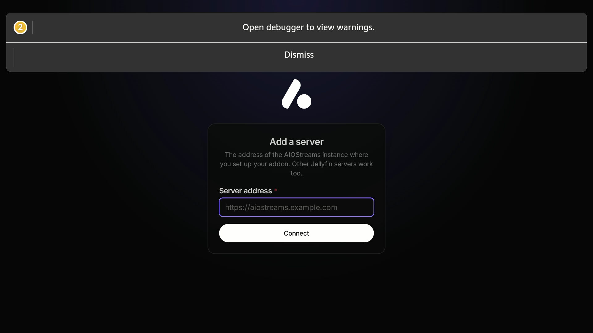

# AIOStreams for Vega OS

An **unofficial** Amazon Vega OS (Fire TV) port of the AIOStreams web client: the client itself,
unchanged in behaviour, inside a small React Native for Vega shell that serves it from the app package in
a Vega WebView.

This package lives in the AIOStreams repository, beside the LG/Samsung packaging in `packages/smart-tv`,
and is developed on the `aiostreams-vegaos` branch — the client-side changes are that branch's commits
against `main`, so `git diff main...aiostreams-vegaos -- packages/web` is the whole of them.

Not affiliated with, endorsed by, or supported by Amazon. The AIOStreams project is licensed
AGPL-3.0-only, and so is this port.



## How it is put together

| Piece | What it is |
| --- | --- |
| **`packages/vega`** (this directory) | A React Native for Vega app whose whole UI is one `<WebView>` loading `file:///pkg/assets/index.html`, plus the script that builds and stages the web client into it |
| **`packages/web` on this branch** | The client-side changes: a `vega` host adapter, Vega key codes, codec-aware audio selection |

The web client does the TV work itself — it lays the page out at 1280×720, runs its own D-pad focus
engine, and plays through its own `<video>` element with hls.js over MSE. The shell adds what a page
cannot do: quitting the app, allowing plain-http servers, and hiding a WebGPU that answers with
nothing. `PORTING_NOTES.md` explains every decision and every bug it took to get there.

This is the same packaging shape the repository already uses for LG webOS and Samsung Tizen
(`packages/smart-tv`): the client's *standalone* build, which picks its own server, plus a platform
manifest.

Like `packages/android` and `packages/desktop`, this package is **outside the pnpm build**: it is a
React Native project with its own `package-lock.json`, installed and built with npm, because the Vega
toolchain expects a project-local `node_modules`. It is listed in `pnpm-workspace.yaml` as an exclusion
(`!packages/vega`), and installed with `npm install --workspaces=false`, since the repository root also
declares npm workspaces and npm would otherwise try to resolve pnpm's `workspace:*` links.

## Prerequisites

- A host the Vega SDK supports: **Ubuntu/Linux or macOS**. Windows and WSL are not supported.
- **Node.js ≥ 20** (built and tested on 26.13.1) and **pnpm ≥ 11** for the AIOStreams workspace.
- **Amazon Vega SDK `2.0.15159`** with **Vega CLI `1.4.9`**, and a Fire TV running **Vega OS 2.0**
  with Developer Mode enabled.
- A physical Fire TV. The Vega Virtual Device **cannot run WebView apps on Ubuntu or Intel Macs**
  (`Module dependency not found: /com.amazon.kepler.webview_4@IWebview_4`).

## Build it

```sh
git clone https://github.com/Viren070/AIOStreams.git
cd AIOStreams
git checkout aiostreams-vegaos          # or: git fetch <your fork> aiostreams-vegaos

pnpm install                            # the workspace, for the client
cd packages/vega
npm install --workspaces=false          # this package alone, outside the workspace

npm run sync-web                        # builds the client's standalone bundle into assets/
source ~/vega/env                       # the SDK is not on PATH by default
npm run build:debug                     # or npm run build:release
```

`vega build` alone is **not** enough: it packages the native side only and leaves out the JavaScript
bundle, and the app then installs and dies with `SIGABRT` before its first frame. Use the npm scripts,
which go through `react-native build-vega`.

`sync-web` builds `@aiostreams/web` from the repository it sits in. Point it elsewhere with
`--repo <path>` or `$AIOSTREAMS_REPO`, and copy an existing build with `npm run sync-web:only`.

## Run it

```sh
vega device list                                  # over the network, connect first:
vega exec vda connect <device-ip>:5555
vega device install-app -b Debug
vega device launch-app -a com.amazondeveloper.aiostreamsvega.main
```

On first launch, type the address of your AIOStreams instance (or any Jellyfin-compatible server) and
sign in — Quick Connect, or the configuration's UUID and password. The address is kept on the device.

To test against a backend of your own, see [`.env.example`](.env.example) for the two variables an
AIOStreams server needs, and run it with `pnpm -F @aiostreams/server dev`.

## Feature status

Verified on a Fire TV Stick 4K (Vega OS 2.0, Vega WebView `Chrome/144.0.7559.246`):

| Feature | Status |
| --- | --- |
| Browse: Home, Discover, Search, Favourites, Calendar, item pages | ✅ Working |
| Version list, including what each version's sound is | ✅ Working |
| D-pad focus navigation and focus rings | ✅ Working |
| Sign-in: Quick Connect and UUID/alias + password | ✅ Working |
| Server over https, and over plain http on a LAN | ✅ Working |
| Back: closes a dialog first, exits the app at the root | ✅ Working |
| Video: H.264, HEVC (including 4K HEVC Main 10) | ✅ Working |
| Audio: AAC, MP3, Opus, FLAC | ✅ Working |
| Audio: Dolby Digital, Dolby Digital Plus, TrueHD, DTS, DTS-HD | ❌ Not supported by the WebView |
| Choosing an audio track inside one file | ❌ No `audioTracks` API in the WebView |
| Subtitles, in-file and external | ⚠️ Untested |
| Trailers, live TV, watch-together | ⚠️ Untested |
| Typing on the on-screen keyboard | ⚠️ Partial: Select releases the field, no input driven |
| Downloads, file saves | ❌ Not supported (no file save in a Vega WebView) |
| Screensaver / keep-awake during playback | ⚠️ Untested; the client's wake lock is unverified |

The audio gap is the port's biggest limitation and it is not a code bug: this WebView decodes no
Dolby and no DTS at all, and the AIOStreams server only direct plays, so a version carrying only a
lossless track plays mute. The client now says so before you pick it. Details, evidence and the
workarounds we considered are in `PORTING_NOTES.md`.

## Repository layout

```
packages/vega/
├── manifest.toml            # the Vega package: components, services, cleartext policy
├── src/App.tsx              # the shell: one WebView, a failure screen, the exit message
├── scripts/sync-web.mjs     # builds the client's standalone bundle into assets/
├── assets/                  # the client, synced. Not committed
├── test/                    # jest test for the shell
├── docs/screenshots/
├── PORTING_NOTES.md         # engineering log: what was adapted, what broke, what the device can do
├── ROADMAP.md               # known limitations and where help is wanted
└── .env.example             # for running a backend to test against

packages/web/                # this branch's changes
├── src/lib/hosts/vega/      # the host adapter
├── src/lib/playback/audio-support.ts
└── …                        # see PORTING_NOTES.md
```

## Licence and attribution

- **AIOStreams** — © Viren070 and contributors, AGPL-3.0-only,
  <https://github.com/Viren070/AIOStreams>. This package and the client changes on this branch are
  under the same licence, the repository's [`LICENSE`](../../LICENSE).
- **Amazon Vega SDK** — proprietary. Nothing from it is included here; build against your own
  installation.
- AIOStreams, Amazon, Fire TV and Vega are trademarks of their respective owners. This package is an
  unofficial community port.
